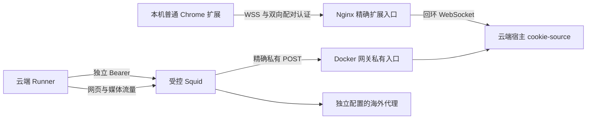

# 云端插件连接

## 状态与目标

本文是用户已确认的设计，落实[云端插件协作需求](../prd/PRD-云端插件协作.md)。现有身份与内容约束沿用[平台身份](15-平台身份.md)和[解析引擎](14-解析引擎.md)。目标是插件直接协作云端 Runner，补齐 X 的 L3 回退；不建设多用户身份池或任意浏览器网络代理。

## 方案选择

| 方案 | 取舍 | 决策 |
| --- | --- | --- |
| 本机身份服务与 SSH 身份通道 | 复用本机服务和既有协议，但依赖本机宿主进程及隧道 | 未选择 |
| 插件直连云端 WSS | 需要云端身份服务与精确公网入口；插件使用时不依赖本机身份进程 | 用户选择 |

实现复用现有 cookie-source 与双向配对协议，不把身份中继加入业务 API，也不把配对密钥放入容器。本地部署与云端部署复用同一插件，通过生成配置选择唯一服务目标；Cookie 始终来自安装插件的普通 Chrome。

## 连接与职责

- 云端 cookie-source 复用现有 FastAPI 应用，在 Linux 宿主的独立 systemd 服务运行，只监听 `127.0.0.1:19101`。CLI 对 Linux 开放服务运行与检查；桌面安装机制保持各自平台行为。
- 公网仅开放 `wss://<显式 HTTPS origin>/identity/extension`，由 Nginx 精确转发到回环 `/extension`；保留扩展 Origin、Upgrade 与既有双向挑战应答。没有公网 Cookie 请求、状态、密钥查询、配对下载或通用转发 API。
- Nginx 在实际 Docker 宿主网关的 `19101` 端口单独监听私有 HTTP，仅转发无查询参数的 `POST /cookies`、`POST /yuanbao-parse`、`POST /identity-result`。`GET /status` 仅限宿主回环检查。保留独立 Bearer、Squid 精确路径 ACL 与无日志约束。
- API、worker、前端不取得身份凭据；业务 Compose 仍只向 Runner 注入私有 `runner.env`。云端身份服务在启动时生成该文件，部署前显式检查其与服务配置一致。
- 公网 WSS 连接使用有效 TLS、固定扩展 Origin、5 秒双向认证期限、既有连接数／消息大小／并发限制与单个已认证 Profile；新增连接不能替换当前认证连接。Nginx 增加有界连接／握手限流，失败不返回认证材料。

## 配置、安装与显示

- CLI 的扩展安装支持显式云端 HTTPS origin；仅允许无账号、无查询串、无片段、无额外路径的 origin。云端模式只生成扩展配置与权限，不启动本机 cookie-source。
- 生成的扩展配置以唯一 WebSocket 目标表示本地或云端连接；本地目标为固定回环 WS，云端目标为上节固定 WSS 路径。所有调用方与测试配套更新，不保留两套配置别名。
- manifest 继续由生成命令维护，CSP connect-src 仅允许所选 WS/WSS 服务与既有元宝接口；WebSocket 不需要 host_permissions，Chrome 匹配规则也不使用 WS/WSS scheme。不申请 scripting、广泛 tabs、webRequest、storage 或任意域权限。平台域权限仍从 Registry 生成。依据 [Chrome WebSocket 示例](https://github.com/GoogleChrome/chrome-extensions-samples/tree/main/functional-samples/tutorial.websockets)和[匹配规则](https://developer.chrome.com/docs/extensions/develop/concepts/match-patterns)。
- 初次配对经部署者已有的 SSH/SFTP 管理通道传递私有配置，配置文件与目录分别保持 0600／0700；不经 Web、公开下载或业务 JSON 发放秘密。扩展生成配置只含配对密钥，Runner Bearer 不进入扩展。
- 云端宿主与插件使用同一配对密钥；密钥轮换需要显式同步两端。已有配置不在普通启动时覆盖，不把认证秘密写到 `.env.prod`。
- 插件面板显示明确的服务目标、连接状态及既有材料／任务结果；文案区分云端服务与本机服务，不回显 Cookie、账号材料、配对密钥或 Bearer。

## X 浏览器回退

- 注册真实 X 浏览器解析器，使用现有 BrowserLayer、浏览器租约、Cookie 注入、媒体探测、下载交接与清理；不通过删除 L3 声明掩盖缺失。
- 浏览器访问 X 自身页面，仅观察 HTTPS 第一方 X／Twitter 域的 TweetDetail、TweetResultByRestId 等明确推文响应；不构造 GraphQL operation ID、签名、事务 ID 或第三方解析请求。
- 从有界响应中匹配源 URL 的精确 status ID，禁止把推荐、回复、引用或其他推文的视频当成目标。显式视频序号必须保留；未指定且多个视频不可唯一对应时拒绝，不静默选错。
- 检查对应作者的公开性与推文限制／保护信号；私密、订阅、付费、地域限制、DRM 或缺失必要公开证明均不能进入 public 下载。
- 仅采用对应视频的 clear MP4 候选，保留真实媒体 ID、时长与格式数据；HLS-only 候选本轮返回明确的格式不可用，不猜测或解密媒体。编解码器与帧率由现有实际媒体探测补全，不写假默认值。
- 最终上下文标记 `x:browser`，维持原出口、身份摘要、原始任务截止时间与内容门禁。平台限制、缺失媒体与运行时故障分别使用既有失败分类。

## 海外出口前提

WSS 只承载已有身份协议，与网络出口解耦，不转发本机网页或视频流量。云端 Squid 仍必须连接部署者独立配置的有效海外上游；当前指向无监听端口的 fallback 不能视为已就绪。此次不把本机代理接入云端，不购买代理，不把现有节点替换为公共代理或声明为住宅节点。

## 验证与发布

- 自动化：本地／云端地址与 manifest 权限校验，错误 Origin／双向认证／第二连接／过期请求／重连，Linux 运行方式，Cookie 与密钥不进入公开路由或容器，X 目标匹配、序号、公开范围、受保护／畸形／无媒体响应与完整操作清理。
- 本地扩展：配套生成配置、重新加载真实 Chrome 扩展，验证显示服务目标、连接、材料可读与错误认证；不自动化用户登录或二次认证。
- 线上：只发布身份服务、精确 Nginx 入口及相关 Runner 更新；保留业务数据、现有稳定密钥及不相关容器。重建前检查在途任务并等待排空，不中断已有解析／下载。
- 验收：插件 WSS 认证连接、Runner 实际请求身份、X 的真实 L3 与 YouTube 正式重新解析分别取得证据；完整下载文件经现有校验。单元测试、连接成功或元数据不能替代平台完整文件验收。
- 若缺少有效海外出口或 Chrome 对目标平台的正常登录，明确记录已完成部分与未完成验收，不宣称线上正常使用已达成。
