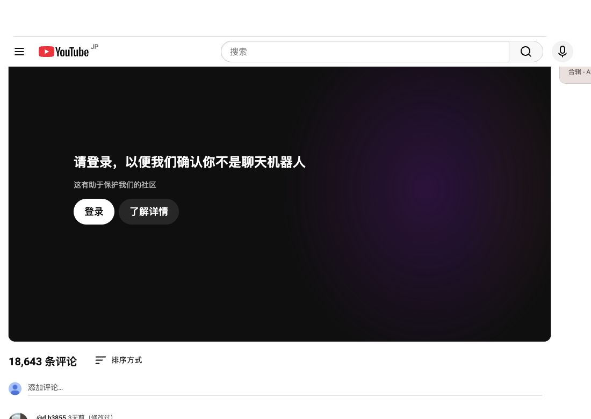
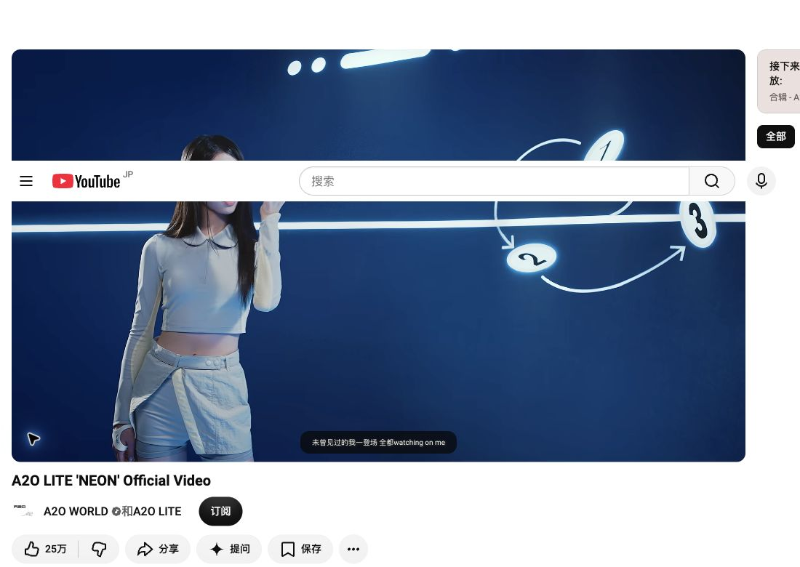
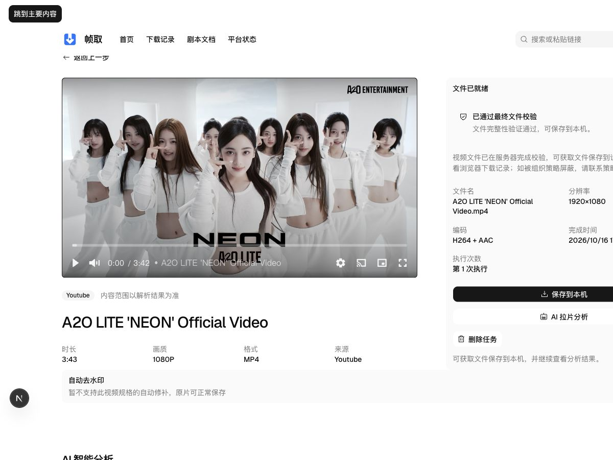
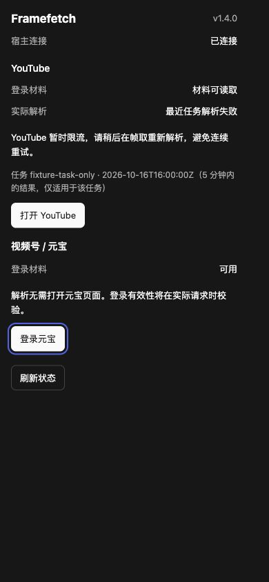
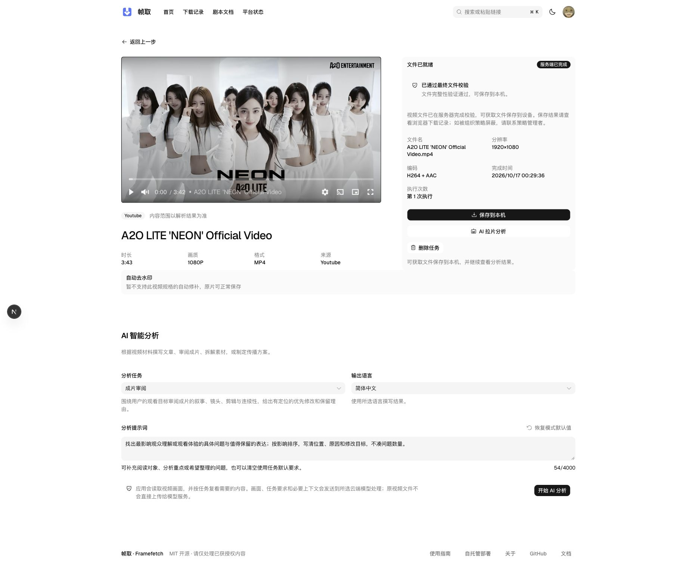
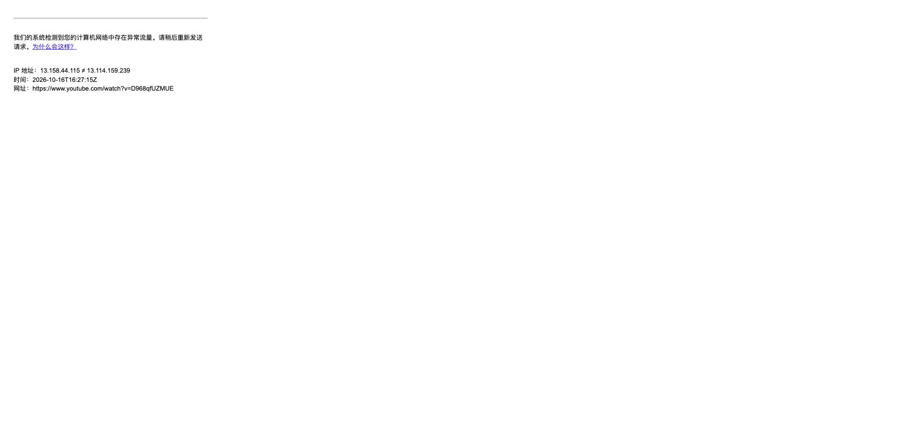
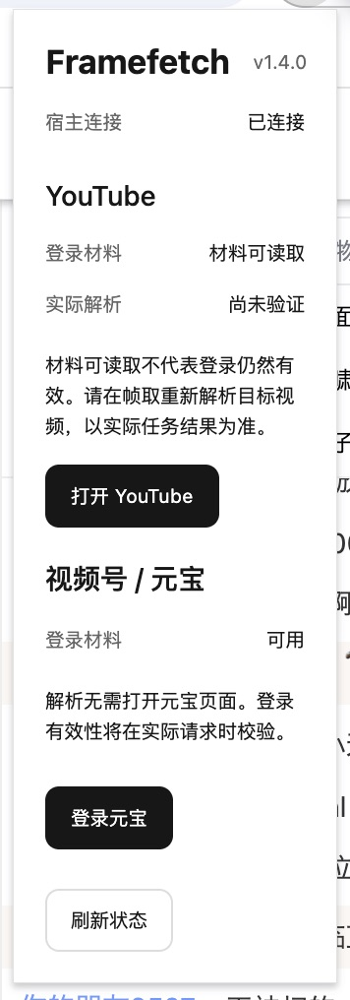

# YouTube 下载失败排查与恢复方案

本计划记录公开 YouTube 单视频解析失败的调查证据、待验证假设与恢复工作包。产品边界沿用[产品定位与边界](../design/01-产品定位与边界.md)，技术规则沿用[解析引擎](../design/14-解析引擎.md)与[平台身份](../design/15-平台身份.md)。当前范围：保持原有节点，复用现有 Chrome 登录态，落地插件 1.4.0 材料诊断与真实任务反馈。宿主与 Runner 已部署，正式 Web／API 1080p 完整文件、独立解码及新面板回执闭环通过；实现、部署与验证边界见[实施工作包](#61-实施工作包)。扩展权限和平台代理节点保持不变，Squid 仅补齐固定宿主回执路径；浏览器保存到本机及受控身份失效／恢复仍待验收。

## 1. 结论与证据边界

截图对应样本为 `D968qfUZMUE`，规范地址为 `https://www.youtube.com/watch?v=D968qfUZMUE`。两次正式解析意图均在 L2 元数据解析阶段以 `rate_limited` 终止，尚未进入完整媒体下载。本轮在同一 Runner、同一受控代理上追加一次匿名解析，直接观察到 YouTube 网页 HTTP 429 与机器人校验提示，返回 0 个格式。

**保持原节点、复用 Chrome 的有效登录态已经实测可行。** 登录态专项当次页面声明 `LOGGED_IN=true`，Chrome 能正常播放同视频；现有 Framefetch 插件提供最新必要身份材料后，正式 Web／API 经 L2 `youtube:mweb` 完成 1080p H.264／AAC 文件，见[原节点登录态与正式下载验证](#26-原节点登录态复用与正式下载验证)。实施后的新 Runner 完整下载和 Chrome 1.4.0 面板闭环又分别通过，见第 6 节；同轮 Chrome 直接导航仍存在异常流量拦截，不将一次接受推断为所有请求永久有效。

此前浏览器出现 `LOGIN_REQUIRED` 的证据保留在[初次 Chrome 实测](#24-普通-chrome-同样本实测)。不同时间的状态不能混为同一次实验：没有受控地执行退出／重新登录或保存凭据值对照，不能断言究竟哪个 Cookie、账号操作或风控变化造成恢复。已确认的是“材料存在”不等于“上游接受”，而当前有效身份已被实际播放和正式下载共同验证。

代理对照仍有诊断价值：美国节点匿名下载成功，日本节点匿名或未被接受的会话曾失败；当前日本节点带有效身份又已成功。因此节点和会话组合影响准入，不能将日本节点判为永久不可用，也不把切换节点作为本任务解决方案。两处 IP 不一致同样不是失败的充分解释。

| 判断 | 证据与限制 |
| --- | --- |
| 不是本次文件下载、合并或全片解码失败 | 正式意图的 `phase=fetch_metadata`、`stage=resolve`；没有到达文件交付阶段 |
| 已有身份仍失败 | 两个意图的 Runner 证据均为 `identity_used=true`；这只证明取得并使用身份材料，不证明 YouTube 接受当前会话 |
| 上游限流确实存在 | 追加匿名复现含明确 `HTTP Error 429: Too Many Requests`，同时出现机器人校验提示；不能据此反推两次带身份请求的原始 HTTP 状态 |
| PO Token 插件已加载，但本次未观察到实际生成 | 匿名复现列出 `bgutil:http-2.0.0`，没有 `Generating a ... PO Token`；很可能在令牌请求之前已被拒绝，不证明生成器本身失效 |
| 当前海外链路使用回退代理 | Runner 未配置 `EGRESS_GLOBAL_UPSTREAM_HOST`；Squid 实际 global parent 为宿主网关的 `7897` 端口 |
| `datacenter` 不是 ASN 实测 | `engine/egress.py` 按是否配置独立上游赋值；配置了上游也不自动证明它是住宅网络 |
| 初次 Chrome 验证未取得播放权限 | 当次 Player HTTP 200，但业务状态 `LOGIN_REQUIRED`，没有 `streamingData`；这是当时的失败证据，不代替当前状态 |
| 登录态专项 Chrome 接受会话 | `LOGGED_IN=true`；同视频 Player `OK`，实际 1080p 播放到 83.303 秒；随后暂停，未执行退出或自动登录 |
| 原节点的正式完整下载已取得 | 正式任务交付 72,082,441 字节、1920×1080、H.264／AAC 文件，全片解码与制品 SHA-256 核对通过；Web 本机保存仍未确认 |
| 未发现相关域名走不同本机策略组 | 实际运行中的 YouTube、Google、账号连接均命中同一手动日本节点；URLTest 与 GLOBAL 的其他选中值不是规则模式下这些连接的实际去向 |
| 不能宣布 YouTube 全平台失效或视频已删除 | 当前只有一个失败视频；旧样本存在完整成功证据，本次 Player 原因是机器人校验，不是删除或 DRM 证据 |

## 2. 采证环境与结果

初始采证环境：2026-10-16，本机正常 Compose 业务服务。源码分支 `main`，检查时 HEAD 为 `9d97a41e`，任务开始时工作区干净。未重启或重建容器，未更换代理节点，未触碰共享基础服务。

### 2.1 正式解析意图

通过 API 容器以只读数据库事务读取下列两个意图的状态与结构化失败。使用项目现有 URL 解封装器在进程内核对样本，仅输出视频 ID 匹配布尔值；未导出密钥、原始加密材料或分享查询参数。两个意图均确认对应 `D968qfUZMUE`。

以下时间为北京时间，来源为数据库记录与 `docker logs --timestamps session-runner`：

| 意图 | 时间与实际客户端路径 | 终态 |
| --- | --- | --- |
| `b90d42a5-98a5-4a18-a7bd-eb113a3a822b` | 15:32:54 创建；15:33:05 `mweb` → `network_blocked`；15:33:12 `tv` → `network_blocked`；15:33:17 `default` → `rate_limited` | `failed`；`L2 / resolve / gate ①`；`retry_after=null` |
| `795f352e-6283-41e5-8ebd-ebc394066018` | 15:37:28 创建；15:37:38 `mweb` → `rate_limited` | `failed`；`L2 / resolve / gate ①`；`retry_after=null` |

共同摘要：`egress_route=global_residential`、`egress_class=datacenter`、`identity_used=true`；当时出口回显为 `43.207.58.47`，出口修订为 `f5fd06ab7c777e7521ca5f13b873b420f0eea03fbe1910b7a1de87b51b55d801`。该 IP 来自回显目标，不保证宿主规则代理把 YouTube、Google Video 与回显服务路由到同一个公网出口。

正式意图未保留原始 stderr，失败记录也没有原始 `http_status`。因此不能把内部 `rate_limited`／HTTP 429 映射直接当成这两次 YouTube 请求返回 429 的抓包证据，也不能从 `network_blocked` 唯一确定是 bot wall、地区限制还是其他匹配规则。

### 2.2 Runner 内最小复现

只执行一次匿名、单视频、跳过下载的检查，使用容器内现有依赖及项目 `youtube_proof bgutil` 包装器；不读 Chrome Profile，不导出或新增 Cookie。临时 HOME 位于 Runner 私有 tmpfs，执行后清理，stdout／stderr 只在进程内处理并输出白名单摘要。

关键参数与生产检查保持一致：`--ignore-config`、项目插件目录、`--js-runtimes node`、`--proxy http://egress-proxy:3129`、`youtube:player_client=mweb`、bgutil HTTP 服务、`--dump-single-json --skip-download --ignore-no-formats-error`；额外禁用缓存、限制 socket 等待与总执行时间，全部重试为 0。

| 项目 | 实测 |
| --- | --- |
| 样本／身份／客户端 | `D968qfUZMUE`／匿名／`mweb` |
| 执行时间／退出码 | 约 6.93 秒／`0` |
| JSON | 视频 ID 存在；`duration=null`、`availability=null`、`formats=0` |
| 网页请求 | `Unable to download webpage: HTTP Error 429: Too Many Requests` |
| Player 提示 | `Sign in to confirm you’re not a bot` |
| PO Token Provider | 已加载 `bgutil:http-2.0.0 (external)`；没有生成令牌的日志 |
| JS Challenge Provider | `node` 可用；未观察到缺少 JS Runtime 或 challenge solving failed |

退出码 0 来自允许无格式错误的检查模式，**不代表解析成功**。项目后续仍需检查格式、公开内容证据及候选文件；不能通过忽略警告、接受空格式或移除校验解决问题。

另一次经同一代理请求 IP 信息服务 `/json` 也返回 429，未取得 ASN／国家信息。它只说明该回显服务自身拒绝请求，不作为 YouTube 限流原因或出口所属网络的证明；本轮没有继续扩大请求量。

### 2.3 运行依赖与部署链路

| 组件 | 本机实际状态 |
| --- | --- |
| yt-dlp | 包版本 `2026.08.19`；安装源固定为提交 `51bab8a0116f4d8004c315706d809782607d5847` 的归档 |
| EJS／Node | `yt-dlp-ejs 0.8.0`／Node `v24.21.0` |
| bgutil | Python 插件与 sidecar 均为 `2.0.0` |
| WPC／Playwright | `yt-dlp-getpot-wpc 1.1.2`／Playwright `1.63.0`；这不证明 WPC 已真实生成令牌 |
| 服务 | Runner `/health/runtime` 为 `ready`；Runner、bgutil sidecar、Squid 均为 `healthy` |
| 代理路径 | Runner 与 bgutil supervisor 均配置 `egress-proxy:3129`；Squid global parent 指向宿主网关 `7897` |

对比容器与工作区的 `commands.py`、`provider_errors.py`、`engine/layers/prepared.py`、`engine/ladder.py`，四个文件 SHA-256 一致。未发现这四个关键文件的容器源码漂移；没有据此宣称整个镜像与 HEAD 完全一致。

### 2.4 普通 Chrome 同样本实测

环境与操作：2026-10-16 北京时间约 15:53—15:56，使用已运行 Chrome 的现有普通 Profile，经已有浏览器连接控制；没有新建浏览器 Profile，没有启动容器 Chromium，也没有读写 Chrome Profile 文件、导出 Cookie、登录账号或调整网络。目标为同一 `D968qfUZMUE`。

| 检查 | 实际动作 | 观察结果 |
| --- | --- | --- |
| 新标签直接访问 | 在现有 Chrome Profile 新标签打开规范 watch URL | 跳转到 `www.google.com/sorry/index`，显示“我们的系统检测到您的计算机网络中存在异常流量。请稍后重新发送请求” |
| 原有页面 | 读取用户已经打开的 YouTube 首页 | 首页能展示推荐；目标标题为 `A2O LITE 'NEON' Official Video`，分享面板视频 ID 与截图相同。这不是播放成功证据 |
| 站内正常点击 | 关闭原分享面板，点击首页中目标视频；页面自带合辑参数保留，视频 ID 不变 | 页面进入目标 watch 状态，但播放器显示“请登录，以便我们确认你不是聊天机器人”；新播放页顶部也显示“登录” |
| Player 网络响应 | 在点击前启用 Network 观察，读取页面自己发出的 `/youtubei/v1/player` 响应；只输出白名单摘要 | HTTP 200、JSON `playabilityStatus.status=LOGIN_REQUIRED`；原因与页面提示一致；没有 `streamingData` |
| 格式与清单 | 检查同一 Player 响应的媒体描述 | `formats=0`、`adaptiveFormats=0`；没有 HLS、DASH 或 `serverAbrStreamingUrl`。长度与作品详情缺失，不能据此建立完整媒体规格 |
| HTML 媒体状态 | 只读查询该页面两个 video 元素 | 两者均 `readyState=0`、`currentTime=0`、无 `currentSrc`、无有效 duration；均暂停；未观察到已绑定的 MediaKeys |
| 实际媒体流量 | 两次连续读取同一事件游标，覆盖点击后的 27 条响应，事件未截断且没有剩余分页 | 没有观察到 `googlevideo.com` 的 `/videoplayback` 响应；仅有 `/generate_204` 的 204 探测，不能当作媒体传输成功 |

直接访问的 Google 提示页显示 `43.206.117.250 ≠ 43.207.58.47`。这只能证明该页报告了两个不同 IP，支持继续核对链路一致性；没有隔离出是代理切换、分流、既有页面状态还是其他因素，不能凭此唯一认定原因。其重定向查询票据不写入文档或证据文件。

脱敏 Player 摘要如下；原始响应仅在诊断进程内处理，没有存入文档、业务库或日志：

```json
{
  "http_status": 200,
  "playability_status": "LOGIN_REQUIRED",
  "reason": "请登录，以便我们确认你不是聊天机器人",
  "streaming_data_present": false,
  "formats": 0,
  "adaptive_formats": 0,
  "hls_present": false,
  "dash_present": false,
  "sabr_present": false
}
```

播放器证据：



**验证结论分层：** 当前普通 Chrome 的页面控制、网络观察及实际 Player JSON 读取成功；目标视频正常播放失败；媒体字节获取、浏览器到 Runner 交接和完整文件验收均未执行，因为没有可交接的媒体来源。不能将后半段标记为实现失败，也不能将前半段读取成功升级为下载可行性通过。

此次诊断使用已有 Codex 浏览器连接的调试能力，不是 Framefetch 扩展新增或已具备该能力的证明。结束后关闭新建验证标签、恢复用户原有首页并关闭失败迷你播放器，关闭 Network 观察；没有更改登录、扩展或代理设置。未触发验证码求解或反复重试。

### 2.5 代理分流、出口与可用节点实测

采证时间为 2026-10-16 北京时间约 16:30—16:41。只读核对系统代理、实际运行的 Mihomo 控制接口、相关连接和 Squid 配置；另用已安装的 Mihomo 二进制启动隔离诊断进程，对照已有订阅中的两个其他节点。没有修改系统代理、当前策略组、TUN、DNS 或应用配置。

#### 本机实际链路

| 对象 | 实测状态 |
| --- | --- |
| macOS 系统代理 | HTTP、HTTPS、SOCKS 均为 `127.0.0.1:7897`；PAC 关闭 |
| Runner | `egress-proxy:3129 → 宿主网关:7897`，与 Chrome 进入相同宿主 mixed 入站；未配置独立 global 上游 |
| Mihomo | 实际版本 `v1.19.32`、`mode=rule`、TUN 开启、IPv6 开启；不能仅凭 TUN 开启认定 Chrome 绕过系统代理 |
| 实际命中策略 | `/connections` 中 `www.youtube.com`、`www.google.com`、`accounts.google.com`、`accounts.youtube.com` 等连接为 HTTPS 入站，链为 `三毛机场 → 2x专线-日本-1`，规则为 `RuleSet(geolocation-!cn)` |
| 容易误读的其他选择 | `GLOBAL` 显示日本 3、URLTest 显示新加坡 3；但实际命中组手动选中日本 1，相关连接没有走这两个选择 |
| 规则限制 | `safebrowsing.googleapis.com` 的 DIRECT 规则不等于 Player／Google 账号／媒体请求走 DIRECT；未发现它是本次播放失败原因 |

运行中核心的 Unix 控制接口来自服务进程参数，和用户目录 YAML 中残留的临时 socket 路径不同。以实际 `/configs`、`/proxies`、`/rules`、`/connections` 为依据，未把旧配置文件或旧日志当成当前状态。只输出必要字段，没有导出控制密钥、节点密码、订阅地址或其他应用的连接清单。

#### IP 与节点对照

回显服务为 Cloudflare trace 与 ipify。YouTube 侧读 watch 页面实际 `remoteHost` 字段，表示该响应中平台声明的客户端 IP，不当作独立网络抓包。测试均未携带账号 Cookie；完整签名媒体地址和 Google 重定向票据未输出或保存。

| 测试路径 | 普通 IP 回显 | YouTube 侧观测及结果 |
| --- | --- | --- |
| 现有 `7897`，日本 1 | 两服务各 3 轮，六次均为 `43.207.58.47` | 两次新 watch 响应含 `remoteHost=43.206.117.250`，Player `LOGIN_REQUIRED`；与前述 Google 提示页的两个 IP 对应 |
| 隔离实例，固定日本 1 | Cloudflare 为 `43.206.117.250` | `remoteHost=43.206.117.250`，IP 一致，但 Player 仍为 `LOGIN_REQUIRED` |
| 隔离实例，固定日本 3 | 两服务均为 `18.183.252.112` | watch 跳转 Google 异常流量页，最终 HTTP 429；页面报告同一 IP；未继续下载 |
| 隔离实例，固定美国凤凰城 | 两服务均为 `142.202.240.77`；另一次 Cloudflare 仍为该地址 | watch HTTP 200，Player `OK`；后一次响应 `remoteHost=142.202.240.76`，时长 223 秒，26 个 adaptive 格式；随后完整下载成功 |

隔离实例只有单一实际节点及最终 MATCH 规则，未创建自动选择或负载均衡组；不启用自己的 TUN／DNS 服务，只监听随机 loopback 端口。节点材料复用已有本机配置，临时目录 0700、配置 0600，日志关闭，进程与配置在 `finally` 中清理；没有持久化新的代理或修改现有连接。

这组对照支持如下判断：

- 当前两处 IP 差异确实可重复观察，不能只用一个 IP 回显服务描述 YouTube 的实际访问来源。
- 当前相关连接没有出现本机自动组切换的证据。相同节点在不同连接／实例上出现多个出口，可能涉及节点域名解析、连接复用或供应商侧出口处理；没有访问供应商内部，不能把具体机制写成已确认事实。
- 固定同一节点和统一观测 IP 都不是“解除风控”的充分条件；日本 1 的隔离一致-IP 试验仍失败。美国节点存在 IP 差异却成功，也排除了“发现 IP 差异就必然无法下载”的结论。
- 单变量匿名页面对照中，日本节点拒绝、美国节点允许；现有日本节点的网络路径／信誉与上游准入是已获得实测支持的主要恢复方向，不要求先重写扩展或升级依赖。

#### 完整文件验证

固定美国节点后，用宿主项目虚拟环境中现有依赖做一次完整下载：yt-dlp 包版本 `2026.08.19`、EJS `0.8.0`、Node 24。使用默认客户端策略，限制单视频、最高 720p、单文件上限 80 MiB，网络重试为 0；使用私有临时 HOME，禁用缓存与配置读取，不使用 Cookie。诊断进程在内存中清空外部 PO Provider 注册，避免另启 WPC 浏览器或误用仍走日本节点的既有 bgutil 服务；没有修改任何模块文件。

| 项目 | 实测结果 |
| --- | --- |
| 视频 | `D968qfUZMUE`；平台页面完整时长 223 秒 |
| 下载结果 | 退出码 0，约 7.22 秒，无 bot／429／403 错误 |
| 文件规格 | MP4；1280×720 AV1 视频、AAC 音频；222.540045 秒；23,492,667 字节 |
| 完整性 | ffprobe 可读；时长与 223 秒相符；`ffmpeg -v error -xerror` 对完整音视频流解码退出码 0，stderr 为 0 字节 |
| SHA-256 | `c1c3e9cf6504f0030777b62fc2030259c5decc648363e1370f495d636ca41284` |

本机诊断制品名为 `D968qfUZMUE-us-diagnostic.mp4`，保留在任务制品目录，未提交媒体文件。这里验证了真实媒体完整传输与解码，强于元数据或健康探针；但没有经过正式下载意图、队列、Runner 候选门禁、制品发布或 Web 保存，也没有记录 default 策略内部最终采用的精确客户端。因此不能称为生产 `mweb + bgutil` 链或三端验收通过。

复核时主策略组仍为 `2x专线-日本-1`，三个诊断目录前缀均无残留。现有 Chrome、Runner 与 bgutil 没有被切换到美国节点；该节点对照不作为本轮切换方案，见[代理对照边界](#54-代理对照结论与本轮边界)。

### 2.6 原节点登录态复用与正式下载验证

采证从 2026-10-16 北京时间约 17:23 开始。用户明确要求不切换其他节点，并选择“先验证登录态和方案”。主策略组复核仍为 `2x专线-日本-1`；没有应用任何节点切换、代理重配或代码修改。

| 环节 | 实际动作与结果 |
| --- | --- |
| 当前 Chrome 登录状态 | 只读检查原有 YouTube 页内配置，`LOGGED_IN=true`；不读取 Profile、账号标识或凭据值 |
| 插件身份通道 | Runner 经现有受控 `/cookies` 通道实时请求 YouTube 身份，HTTP 200；必要材料规则满足，未记录 Cookie 值或身份摘要。材料仅在诊断内存／私有 tmpfs 使用并清理 |
| Chrome 同样本播放 | 从原有页面点击 `D968qfUZMUE`；网站自己的 `get_watch` 响应含 Player `OK`、完整时长 223 秒、1 个 formats 与 26 个 adaptiveFormats，并有 SABR 引用 |
| 实际媒体访问 | 观察到多条 `googlevideo.com/videoplayback` HTTP 200，MIME 为 `application/vnd.yt-ump`；video 为 blob 来源、1920×1080、`readyState=4`、时长 222.501 秒，实际播放到 83.303 秒后暂停 |
| Runner 最新身份解析 | 使用现有 `fetch_identity`、`MediaCommands`、`youtube:mweb` 与既有 bgutil，约 10.13 秒解析成功；`availability=public`、完整时长 223 秒、34 个带 URL 的非 DRM 候选。该诊断不经业务意图，不能单独替代正式验收 |
| 正式 Web／API 解析 | 在帧取首页提交同一规范 URL，新意图 `78a3cdc0-4bbc-40b0-a3ad-9bc755cddba5`、Inspection `d1c28294-99ba-4c88-8820-c7d049e45d82`；页面显示“公开内容 · 使用 Chrome 身份”，整理后 22 种可选方案 |
| 正式下载与发布 | 页面选择 1080p MP4 H264／AAC，任务 `188dd687-9038-42e8-9a25-7fd42183b0e9`；17:25:25 创建，17:25:45 完成，首次执行即 `succeeded`、100%，无错误码，页面显示已通过最终文件校验 |
| 正式执行上下文 | `L2 / youtube:mweb`、`identity_used=true`、`global_residential / datacenter`、当次出口回显 `43.206.117.250`。类别仍只是配置标签，不改写为住宅节点 |
| 发布制品 | Artifact `fcaa8856-cccd-45b0-bfc9-117ae2b3c440`；MP4，1920×1080 H.264／AAC，222.540045 秒，72,082,441 字节 |
| 独立文件验证 | 只读从该已发布制品存储取回到任务制品目录；ffprobe 规格、时长与大小一致；严格整片音视频解码无错误；SHA-256 与制品表一致：`288ee5a1326c361023300a09bd05d209489ffde068ab1525b24293c674fb639a` |
| Web 保存边界 | 已点击“保存到本机”并观察到 Chrome 系统保存窗口，但未取得浏览器最终落盘路径；不能把存储取回的校验结果称为网页保存通过 |

当前 Chrome 播放证据：



正式任务交付证据：



**结论：现有插件的按任务读取身份能力已经可用，原节点无需切换即可完成本样本正式下载。** 最小优化目标应先解决用户无法辨认“扩展已连接、材料存在、上游已接受、视频可处理”这几种状态的问题。没有证据支持为了本样本立即重写成浏览器媒体抓取器。浏览器实际使用 UMP／blob，也说明复制 video.src 不是可靠的完整文件方案。

本次只覆盖一条目标正例，不覆盖稳定性、第二条独立正例、退出／轮换／不同账号的受控负例或原生端保存。Chrome 登录动作与 Cookie 变化没有在受控实验中追踪，不能把恢复唯一归因于某个凭据字段；也不能否认出口信誉仍可能影响其他任务。

## 3. 当前链路如何产生页面错误

| 环节 | 当前实现与本次表现 | 源码 |
| --- | --- | --- |
| 身份 | `prefer`，由扩展提供；本次正式请求取得身份 | [Provider](../../backend/app/workers/runner/provider_catalog_core.py)、[身份规范](../design/15-平台身份.md) |
| 出口 | 海外路由，未配置专用上游时使用宿主代理回退；路由名不等于实际网络类型 | [出口绑定](../../backend/app/workers/runner/engine/egress.py)、[Squid 启动](../../backend/egress/start.sh) |
| L2 客户端 | 按 `mweb → tv → default` 尝试；网络／挑战／格式等错误允许客户端回退 | [PreparedLayer](../../backend/app/workers/runner/engine/layers/prepared.py) |
| 限流终止 | `rate_limited` 不属于客户端或层回退条件；无 `Retry-After` 时结束。有合法等待时间且预算足够才允许同层一次重试 | [Ladder](../../backend/app/workers/runner/engine/ladder.py) |
| L3 WPC | 作为另一个令牌提供者，仍由 yt-dlp 提取；本次两个意图在 L2 限流停止，未到达 WPC | [WPC 入口](../../backend/app/workers/runner/engine/browser/youtube.py)、[提供者选择](../../backend/app/workers/runner/youtube_proof.py) |
| 分类 | bot 提示、显式 HTTP 429 和模糊登录／限流提示有不同规则；缺少原始 stderr 时只能保留已记录的分类 | [错误规则](../../backend/app/workers/runner/provider_errors.py)、[命令执行与元数据检查](../../backend/app/workers/runner/commands.py) |

不尝试 WPC 与当前[重试规格](../design/14-解析引擎.md#7-阶梯执行)一致，不能仅因没有 L3 日志就认定回退实现缺陷。应先验证出口／会话；不要把明确限流改成继续遍历全部客户端或浏览器的触发器。

## 4. 上游调研

以下为采证时读取的上游一手文档与发布说明，属于外部行为参考，不代替本机验收。

| 来源 | 与本问题有关的结论 |
| --- | --- |
| [yt-dlp YouTube Extractor 文档](https://github.com/yt-dlp/yt-dlp/wiki/Extractors#youtube) | 默认客户端受限时建议 `mweb + PO Token`；账号 Cookie 会轮换；应控制请求量。项目当前客户端方向与其一致 |
| [PO Token Guide](https://github.com/yt-dlp/yt-dlp/wiki/PO-Token-Guide) | Player、GVS、字幕令牌用途不同；令牌有会话／视频绑定，宜由 Provider 动态生成；`tv` 也可能只提供受保护或 SABR 格式 |
| [bgutil 使用与验证说明](https://github.com/Brainicism/bgutil-ytdlp-pot-provider#verification) | 插件加载与实际生成令牌是两件事；Player 先被拒绝时可能根本不触发令牌生成；令牌不保证解决基于 IP 的登录／bot 限制 |
| [EJS 文档](https://github.com/yt-dlp/yt-dlp/wiki/EJS) | Node 需显式启用，最低版本 22；当前 Node 24 与命令配置满足基础要求。EJS 与 PO Token 各司其职 |
| [WPC 上游](https://github.com/coletdjnz/yt-dlp-getpot-wpc) | 实验性浏览器令牌 Provider，需要 Chromium；它不承诺解决所有网络限制，也不是完整浏览器下载器 |
| [yt-dlp 2026.08.19](https://github.com/yt-dlp/yt-dlp/releases/tag/2026.08.19) | 查询时稳定版入口仍指向此版本；包版本相同不代表项目固定提交与发布提交完全一致，未确认后续提交能解决本样本 |
| [bgutil 2.0.1](https://github.com/Brainicism/bgutil-ytdlp-pot-provider/releases/tag/2.0.1)、[2.0.2](https://github.com/Brainicism/bgutil-ytdlp-pot-provider/releases/tag/2.0.2) | 项目 `2.0.0` 后有依赖安全更新；发布说明没有承诺修复本样本的 429。升级有维护价值，但不是本次根因已获修复的证据 |

## 5. 假设与解决方案排序

### 5.1 优先验证普通 Chrome 直接参与解析与传输

本节保留浏览器接入研究。原节点通过现有插件身份通道已完成正式下载，当前优先完善[登录态诊断与插件方案](#55-不切换节点的最小插件优化提案)。只有现有身份链在真实证据中无法交接必要访问状态时，才继续浏览器内媒体获取研究。

当前 YouTube 路径只通过扩展读取 Cookie，再由容器内 yt-dlp 重新发起网页、Player 和媒体请求；没有复用用户正在正常访问的 Chrome 页面。Cookie 不包含整个浏览器运行状态、页面脚本执行结果与连接行为；实际出口也可能不同。目前未隔离出这些差异中哪一项导致拒绝。WPC 同样是另起浏览器生成令牌，不等于接入用户的日常 Chrome。

检查 [扩展 manifest 模板](../../extension/manifest.template.json)与[后台入口](../../extension/background.js)：现有权限及消息路径支持 Cookie 身份和视频号专用 HTTP 解析，没有 YouTube 页面解析／媒体传输能力。因而“直接使用 Chrome 内容”是可以研究的实现方向，目前尚未接入。

建议的验证顺序：

1. 在用户日常 Chrome 的同一 Profile 中验证目标 `D968qfUZMUE` 是否正常公开播放，记录为独立于 Runner 的结果。
2. 通过任务限定的扩展能力，读取该 YouTube 页面真实的播放器信息并观察它自行发起的媒体请求，验证能否取得可完整交付的非加密音视频。先证明能力，再确定扩展权限和协议；不读取 Profile 文件、不复制整份浏览器配置、不让服务端下发任意脚本。
3. 验证媒体交接：只有实测允许外部请求重用时才交给 Runner；若访问依赖原浏览器上下文，则研究在同一 Chrome 内取得完整媒体，再经有界本地传输交给后端合并和校验。仅把直链或 Cookie 交回容器不能算浏览器方案已经成立。
4. 检查完整时长、可选画质、音视频分离、分段覆盖、取消清理及文件大小限制，最后仍执行正式完整文件验收。播放器可播、页面信息或若干分段可读都不证明整片已可下载；只取得 SABR／受保护形式时需独立评估，不能把它当作现成 MP4 地址或绕过现有保护边界。

Chrome 官方提供 [scripting](https://developer.chrome.com/docs/extensions/reference/api/scripting) 以在获准页面执行扩展脚本，提供 [webRequest](https://developer.chrome.com/docs/extensions/reference/api/webRequest) 观察请求生命周期，也可通过需额外权限的 [debugger](https://developer.chrome.com/docs/extensions/reference/api/debugger) 接入受支持的调试域。这些 API 说明存在浏览器侧接入途径，不证明当前 YouTube 的完整文件一定能取出；页面访问、请求观察和响应内容读取需分别验证，不能混为一种能力。

初次浏览器实测被拒绝，但当前已登录 Chrome 能播放，原插件读取身份后正式 Runner 也已交付完整文件，见[登录态复验](#26-原节点登录态复用与正式下载验证)。浏览器内媒体获取仍是条件性提案，未改动既有 Design 或扩展权限；当前无需用它替换已可工作的身份交接链。

### 5.2 Runner 对照假设

| 优先级／假设 | 支持证据 | 最小区分实验与处理 |
| --- | --- | --- |
| 已支持：节点与会话组合影响准入 | 日本节点匿名／初次会话被拒绝；同一日本节点复用当前有效 Chrome 身份，正式下载已通过 | 本任务保持原节点，优先完善身份状态诊断和重新解析引导；不能仅凭旧 bot 墙判断当前节点不可用 |
| 账号必要性取决于访问上下文 | 美国节点匿名成功；原日本节点当前有效 Chrome 身份也成功，身份材料存在本身不证明平台接受 | 保持原节点复用实时身份，结合实际任务验证有效性；不要求手工导出长期 Cookie，也不替用户自动登录 |
| 本机域名分流未被证实为主因 | 当前 YouTube／Google／账号连接均走同一手动组；同名节点下平台侧与回显 IP 仍有差异 | 使用实际连接链与平台侧 remoteHost 核对；保持相关组件同路由，不用回显 IP 或节点名代替端到端验证 |
| 生产客户端链已有当前正例 | 原节点、现有扩展身份、正式 L2 `youtube:mweb` 已完成完整下载；没有为了此样本升级依赖 | 现有链路保持不变；只有新失败出现具体令牌／challenge 证据才定位 Provider，WPC 单独验收 |
| 本样本的删除／强制账号假设不成立 | 同一 ID 在美国节点匿名 Player `OK`，得到完整可解码音视频 | 其他样本的公开、付费、地域与保护边界仍逐一验证；不把一个正例推广为平台全量通过 |

出口配置用于解释 Chrome 与 Runner 的差异，不作为优先解决方案的前提。只有对照证明差异来自路由时，再评估现有 `EGRESS_GLOBAL_UPSTREAM_HOST/PORT` 与宿主代理规则。若后续切换节点，按既有规格更新 `EGRESS_NODE_REVISION` 并重新解析，旧检查结果不能直接续用。配置动作本轮未执行；不引入账号池、代理轮换池或公共解析服务。

依赖升级安排为独立维护工作包：固定 yt-dlp 提交、EJS、JS Runtime、bgutil 插件与镜像及 WPC 的组合，重新建立真实验收；不要只因为版本存在更新就将它写成 429 的修复方案。

### 5.3 Chrome 接入的具体实施提案与决策门槛

以下描述待验证方案，尚未写入生效的接口或身份规格。尤其是[现有身份规范](../design/15-平台身份.md#1-组成)明确不申请页面脚本和请求观察权限，若采用本提案，需要先明确调整对应 Design，再实施扩展权限、消息与三端联动。

| 环节 | 具体方案 | 继续条件与失败处理 |
| --- | --- | --- |
| 任务入口 | 由现有解析意图发起限定 YouTube、限定视频 ID、task ID、request ID 与原 deadline 的浏览器任务。通过已认证宿主连接送至配对的普通 Chrome Profile；不开放任意页面、脚本或代理接口 | Profile 或扩展不匹配、断开、超时均返回结构化失败；不会另起一个未登录 Profile 冒充复用 |
| 页面与响应 | 优先复用或创建任务绑定的目标标签，让网站自己的播放器生成请求；读取 Player 状态与最小媒体字段。当前实验用 Network 域已证明可读响应，但产品所需的最小权限仍需单独确定 | 像本次 `LOGIN_REQUIRED`／bot 提示时立即停止并提示用户在同一 Chrome 确认播放；不自动化密码、验证码，不把 HTTP 200 当成可下载 |
| 候选与范围 | 只接受目标视频对应的、可证明公开免费且非加密的音视频候选，记录原始完整时长、画质、编码和来源绑定 | 页面标题、缩略图、评论或 `/generate_204` 不算候选；SABR 不自动等于 DRM，也不自动等于普通可下载文件，其传输能力需独立验证 |
| Runner 交接试验 | 确有媒体后，使用同一候选做一次受限前缀读取，比较 Chrome 与 Runner 结果；临时签名地址只经受控内存通道交接，不进入日志、业务 JSON、队列或持久字段 | Runner 能读取正确媒体前缀后，仍需验证完整文件；若 Chrome 能读而 Runner 被拒绝，则不继续重复复制 Cookie／地址 |
| 浏览器内获取 | 若证明媒体绑定浏览器，验证由同一 Chrome 完成完整 clear 媒体读取，再交给宿主暂存与后端合并校验 | 本次没有验证该能力。后续必须明确跨域读取、分段覆盖、Range、取消、总大小、流控和 MV3 生命周期；不能直接承诺仅增加 fetch 即可实现 |
| 二进制传输 | 控制消息与媒体字节分离；研究任务绑定、一次性、仅 loopback 且经认证的有界流式通道，再由宿主对接后端 | 现有 `protocol.js` 普通消息上限 1 MiB、视频号解析消息约 4 MiB；不把整个视频 base64 塞入身份 WebSocket，不以取消现有限额代替传输设计 |
| 上下文与文件验收 | 保留统一 Runner 的合并、时长／音视频校验、SHA-256 与严格整片解码；记录真实的 Chrome 执行来源及绑定摘要 | Chrome 路径的执行上下文字段、修订和下载前重验规则需在 Design 中明确，不能伪填成原 L2 客户端或假定浏览器与容器出口相同 |

实施决策门槛为：同一 Chrome 的目标先可正常播放并产生真实非加密媒体 → 有完整时长与候选 → 至少一条媒体实际获取路径成功 → 完整文件通过统一校验。未跨过媒体获取门槛前，不开始大规模扩展协议或下载器改造。

### 5.4 代理对照结论与本轮边界

本任务保持现有节点，不实施节点切换、Clash 分流重配或新增入站。美国节点的隔离成功只作为网络／会话准入对照，原日本节点带有效身份的正式成功证明切换节点不是本样本的必要前置。不能再将“切到美国节点”列为当前实施方案。

系统代理、Squid、Mihomo 的观测方法与 IP 限制继续保留；固定出口的已有规格只在[运行说明](../../README.md#固定出口与-clash-住宅节点)与 Design 维护，不因为本次用户偏好改写既有安全边界。Mihomo [规则](https://wiki.metacubex.one/config/rules/)、[手动组](https://wiki.metacubex.one/config/proxy-groups/select/)及 [Listener](https://wiki.metacubex.one/config/inbound/listeners/#proxy) 文档仅解释路由机制，不等于需要本轮应用配置。

### 5.5 不切换节点的最小插件优化提案

**目标：让用户清楚知道当前普通 Chrome 的身份是否已传递、是否被 YouTube 接受，并在失效时正常登录后重新解析。** 保留现有扩展 → cookie-source → Runner 的任务级通道；不扩大内容权限，不保存 Cookie，不自动化账号密码、验证码或 2FA。本轮按此范围实施，协议与状态的唯一有效规格见[平台身份诊断](../design/15-平台身份.md#7-youtube-身份诊断)。

当前源码证据：[popup.html](../../extension/popup.html)和[popup.js](../../extension/popup.js)只展示宿主连接与元宝材料，缺少 YouTube 的材料状态、正常登录入口与目标解析的状态解释。[cookie-source](../../backend/app/workers/identity/cookie_source.py)已有 YouTube 必要材料规则，且源码明确其不证明账号有效；[后台](../../extension/background.js)每次状态读取目前也只调用元宝状态函数。这是可具体改善的使用缺口，不能将它描述成 Cookie 通道失效。

| 优化项 | 拟定行为 | 验证条件 |
| --- | --- | --- |
| YouTube 材料诊断 | 在插件面板单独展示“扩展已连接”“缺少材料／材料可读取”，沿用宿主唯一必要材料规则，不复制另一套 Cookie 判定；结果只含非敏感状态 | 缺少材料、过期或源断连分别可见；材料存在时也不能直接标“已通过平台验证” |
| 有效性反馈 | 将最近一次同站点、同任务的实际 Runner／Player 接受结果与材料状态分开。没有实际请求结果显示“尚未验证”；只在来源、任务、材料摘要与时间范围匹配时展示接受结果 | HTTP 200 但 `LOGIN_REQUIRED` 不显示成功；一次旧成功不能为新账号或新目标背书，状态缓存只保留必要非敏感摘要 |
| 正常登录入口 | 提供固定 YouTube 官网入口，让用户在当前配对的普通 Chrome Profile 中正常确认登录、播放目标；插件不接收账号密码，不复制 Profile | 不打开任意 URL 或另一个 Profile；用户现有页面可复用，但不能把 Chrome 的个人资料头像当成 YouTube 登录成功 |
| 刷新与重新解析 | 刷新时读取最新材料；材料变化使旧有效性显示失效。引导用户在帧取重新解析，沿用显式新 generation 和原有上下文核对 | 不后台无限刷新，不延长旧 deadline，不绕过下载前身份摘要核验；不自动复制旧 Inspection 继续下载 |
| 失败引导 | 保留网络、限流、登录和内容限制的分类，同时提示先在当前 Chrome 确认同一视频是否可播；依据证据显示登录失效或平台仍拒绝 | 不把每个 bot 提示都自动解释成未登录，也不把 `identity_used=true` 当成平台已认证；默认不要求换节点或清空 Cookie |
| 权限与协议 | 优先使用现有 Cookie 和任务状态链，实现范围只覆盖 YouTube 诊断及固定登录入口，保留元宝流程。需要新增非敏感反馈消息时，先同步唯一 Design 和严格消息校验 | 最小方案不预设增加 `debugger`、`webRequest`、`scripting` 或广泛 `tabs` 权限；不把完整响应、Cookie 或账号标识塞进面板／业务 JSON |

如果后续受控测试证明 Cookie 材料完整、Chrome 同目标可播而 Runner 持续失败，再单独评估第 5.3 节的浏览器执行能力。该能力涉及权限、任务来源绑定和 UMP／SABR 等真实媒体传输，不归入本轮最小优化；本次浏览器流量不是直接 MP4，不能仅复制 blob 地址交接。

验收以当前日本节点不变为约束：连接／材料／实际接受状态必须一致可解释；同样本正式解析与完整下载通过；失效材料和 Chrome 登录恢复的负正例能稳定复现；只有受控对照成立后才归因。所有敏感材料继续只经现有私有通道短暂使用。用户已授权落地功能；实现不增加扩展权限，实际完成状态与验证范围见第 6 节。

## 6. 后续工作包与验收

| 工作包 | 状态 | 完成条件 |
| --- | --- | --- |
| 证据核对与调查 | 已完成 | 截图样本与两个正式意图匹配；有匿名上游 429 复现、运行配置和源码检查；证据与推断分开 |
| 普通 Chrome 目标与 Player 验证 | 当前登录态正例通过 | 保持原节点，当前 Chrome 声明已登录，同视频 Player `OK`、1080p 正常播放；初次拒绝与当前接受分开记录 |
| 浏览器内媒体获取与交接 | 条件性研究；未实现 | Chrome 当前实际走 UMP／blob；原 Cookie 身份链已可完成正式下载，不为本样本新增浏览器下载子系统 |
| 代理分流与匿名节点对照 | 已完成 | 核对实际规则／链；日本 1、3 失败，美国节点匿名 Player 成功；分离本机选组、平台侧 IP 和节点准入问题 |
| 隔离完整文件诊断 | 已完成；单样本 | 同版本 yt-dlp／EJS、美国节点、无 Cookie，取得 720p 完整文件，时长／全片解码／SHA-256 已记录；不等于正式 API 验收 |
| 原节点正式 Web／API 验证 | 单样本通过 | 任务 `188dd687-9038-42e8-9a25-7fd42183b0e9`，L2 mweb、Chrome 身份、1080p H.264／AAC，完整文件／发布／独立解码与 SHA-256 通过 |
| 插件登录态诊断优化 | 已部署；真实面板正例通过 | Chrome 1.4.0 材料状态与真实 Runner 任务回执匹配；受控登出／登录恢复的真实负正例仍待完成 |
| 身份必要性与其他样本 | 待验证 | 本样本匿名已成功；其他公开样本是否需要有效身份逐一记录，不把 Chrome 扩展“材料可用”等同于上游会话有效 |
| 令牌与依赖对照 | 条件执行 | Player 已可访问后验证 bgutil 实际生成；必要时验证现有 WPC 或隔离升级。明确限流时停止，不为完成矩阵继续发请求 |
| 诊断改进评估 | 待决策 | 若现有证据仍不足，评估有界 `cause_code` 区分网页 429、Player bot wall、会话无效、令牌失败；不得把分类映射伪装成原始 HTTP 状态，不保留原始敏感响应 |
| 第二样本与端侧验收 | 待完成 | 当前目标正式完整文件已通过；第二条独立正例、Web 保存到本机最终落盘／哈希比对及原生端仍未完成 |
| 边界与失败恢复 | 待执行 | 保护／权限负例按契约拒绝；限流遵循 Retry-After 与原预算；节点变化触发重新解析；没有空格式成功或请求放大 |

当前原节点已取得 Chrome 实际播放与正式 Web／API 完整文件正例，现有插件身份链在本样本中可工作。保持原代理节点；已完成新版扩展实际重载与真实任务回执闭环；尚未完成受控账号失效／恢复对照、第二样本、WPC 生成、Web 最终落盘或原生端验收，不宣称所有风控问题已消除或浏览器内媒体交接已实现。剩余范围与[平台验证记录](../design/14-解析引擎.md#13-验证状态)保持一致。

### 6.1 实施工作包

沿用[最小范围](#55-不切换节点的最小插件优化提案)，按宿主诊断 → Runner 回执 → 插件面板实施。接口只增加私有身份通道，不变更业务 OpenAPI、数据库、App 或 Electron 页面。

| 工作包 | 文件与接口 | 状态与完成条件 |
| --- | --- | --- |
| 宿主诊断 | `cookie_source.py` 的 `youtube_status()`、`record_result()` 与私有 `/identity-result`；沿用 `cookies()` 校验 | 已实现；材料缺失、旧任务、材料变化、过期、断连、忙碌及严格字段测试先失败后通过；真实扩展回路已通过 |
| Runner 回执 | `identity.py` 的 `report_youtube_result()` 与 `ladder.py` 最终结果接线 | 已实现；私有路由与摘要、匿名／过期跳过、失败不影响业务、成功／登录／网络失败接线测试通过 |
| 扩展交互 | `protocol.js`、`background.js`、`popup.*`；版本 `1.4.0` | 已实现；固定官网入口、有界状态等待、断连清理、非法字段拒绝与面板分态测试通过；元宝流程保留 |
| 集成与交付 | 宿主升级、Runner 构建、Chrome 重载、原节点正式目标重测 | 宿主与 Runner 已升级，原节点正式完整下载复验通过；Chrome 1.4.0 重载及面板回执闭环已通过 |

面板的“最近任务解析通过”只表示携带当前材料完成该目标解析，不声称已证明账号认证。没有回执、状态服务忙碌或失联时显示尚未验证；刷新不会启动解析或复用旧画质结果。实际验收证据见本节后续记录。

### 6.2 实施验证记录

- 扩展：`node --test extension/*.test.cjs`，45 项通过。覆盖固定官网入口、来源拒绝、状态等待／断连、迟到响应不能完成新刷新、材料与实际结果分开、网络／登录分类及元宝回归。
- 后端：按仓库命令 `uv run --frozen pytest -q -rs`，最终代码 3787 项通过、5 项跳过。跳过为未提供隔离 MinIO 的上传边界集成测试，以及本机 macOS 无法执行的 4 项 Windows ACL／junction 测试。先前直接调用虚拟环境 pytest 时，23 项 Runner 签名／清理相关测试因 PATH 未包含虚拟环境 `yt-dlp` 而被运行时门禁拒绝，另 1 项扩展版本断言需同步；已改用规范命令并同步版本断言后全量通过，没有放宽生产门禁。
- 静态与契约：Ruff 检查／格式通过；Mypy 598 个文件通过；从当前源码导出业务 OpenAPI 并执行 `pnpm openapi:check`，生成文件无差异；开发、生产与基础设施 Compose 均可解析；文档结构检查 42 份通过。
- 浏览器：当前 Chrome 在受控 HTTP 页面加载真实 `popup.html/js/css`，以明确标记 `fixture-task-only` 的测试状态检查桌面与 390px、明暗主题、材料缺失／断连／限流、键盘焦点。390px 无横向溢出，默认限流面板内容高 582px，焦点样式可见。这是 UI 夹具验证，不是扩展或 YouTube 的真实状态证据。
- 宿主：通过现有 `install` 命令升级当前用户服务并生成 1.4.0 manifest，保留原配对与 Runner Bearer，不改项目 env。首次立即 `check` 因服务尚在重启而未就绪；服务端完整下载复验时连接 Chrome 1.3.3；用户重载后已确认 `connected=true, version=1.4.0`，真实面板材料读取成功。
- 节点：只读控制器确认实际选择仍为 `2x专线-日本-1`，本轮未修改代理、节点或分流规则。
- Runner：最终镜像已构建，仅经正常 Compose 重建 `session-runner`；切换前数据库确认无排队／运行／重试等待下载，保留已有 Runner 工作与浏览器卷。新容器健康，实际 `19100/health/runtime` HTTP 200；容器内 `identity.py` 与 `ladder.py` SHA-256 均与最终工作区一致。API、worker、Web 与基础服务未重建。
- 扩展重载：管理页导航受浏览器安全策略限制，由用户手动对现有扩展完成重载；随后通过普通工具栏扩展菜单打开面板并读取状态，没有访问管理页或绕过其导航限制。真实面板材料状态与任务反馈正例见第 6.4 节。



### 6.3 最终部署的原节点正式复验

同样本 `D968qfUZMUE` 的新正式意图为 `2fee2450-be9c-4629-900b-e90272fe9769`，Inspection 为 `c435fe4b-5c5b-4a90-a673-a9717fb7589f`。从当前 Chrome 打开正式 Web 首页提交解析，得到 22 组格式，选择 1080p MP4 H.264／AAC 并开始下载。

- 任务 `53941bfa-de71-4bea-984f-5c6ee546efdd` 首轮成功；制品 `423b03bd-008b-4f00-9ca0-68cdd4393385`，界面显示文件就绪及最终文件校验通过。
- 当前新 Runner 的实际上下文为 L2 `youtube:mweb`、`identity_used=true`、`global_residential`、出口类别 `datacenter`、观测 IP `13.158.44.115`；原选择仍是日本 1，没有为此任务切换节点。
- 从已发布私有存储独立取回文件，`ffprobe` 为 1920×1080 H.264／AAC、222.540045 秒、72082441 字节；对全部音视频执行 `ffmpeg -xerror -err_detect explode ... -f null -`，退出 0，无解码错误。SHA-256 与数据库一致：`288ee5a1326c361023300a09bd05d209489ffde068ab1525b24293c674fb639a`。文件字节摘要也与先前正式样本一致。
- 同轮当前 Chrome 直接导航 YouTube 目标，反而进入 Google 异常流量页，页面报告 `13.158.44.115 ≠ 13.114.159.239`；未求解验证码或连续重试，未取得本次 Player 接受证据。宿主现有 Cookie 通道读取返回 200、必要材料可读。这组事实说明：相同固定节点并不保证平台侧只有一个出口 IP，不同请求上下文的准入结果也可能不同，不能把 Chrome 直开失败推断成 Runner 也必然失败，或把必要材料存在推断成账号已被认证。
- 该完整下载复验发生在 Chrome 扩展仍为 1.3.3 时；1.4.0 新面板的真实回执闭环另见第 6.4 节。未点击本任务 Web“保存到本机”，独立存储取回不等于浏览器保存流程已验收。受控登出／重新登录、第二样本、原生端与 L3 WPC 的剩余边界保持待验收。





### 6.4 Chrome 1.4.0 重载后的真实回执闭环

用户手动重载后，宿主 `check` 返回 `connected=true, version=1.4.0`。通过 Chrome 工具栏的普通扩展菜单打开 Framefetch，实际面板显示宿主“已连接”、YouTube“材料可读取”及“尚未验证”；已有材料没有被直接标成平台验证通过，元宝材料状态仍正常。

真实接线首次检查发现一个遗漏：新 `/identity-result` 没有同步到 Squid 的精确路径白名单。真实 Runner 解析任务 `youtube_ext_7998c62ef9884b49970b69f413edd1a3` 已成功，但回执被代理 403 拒绝，因此面板继续显示尚未验证。该失败是诊断回传断路，并非实际解析失败；不能用此前单元测试与正式文件成功替代这一步验收。

- 对现有 Squid 规则增加唯一固定路径 `/identity-result`，保持固定宿主、端口 19101、POST、私网拒绝顺序及 `always_direct`；不修改 Clash 节点、分流或上游配置。
- 回归测试先稳定失败，再修复路径；15 项 egress 配置测试通过。当前 Squid 配置先通过 `squid -k parse`，再按现有 Compose 容器执行 reconfigure，不重建代理或其他服务。
- 从真实 Runner 经代理请求新路径，无 Bearer 从代理 403 变为宿主 401；GET、尾随斜线及查询参数仍为代理 403，原鉴权与路径边界保留。
- 使用 API 容器现有类型化 Runner 客户端，发起新的真实 HMAC 签名解析 `youtube_ext_45670993073c4896a1e924fbe31f22fd`，目标 `D968qfUZMUE`。返回 223 秒、22 组格式，L2 `youtube:mweb`、`identity_used=true`、观测 IP `13.114.159.239`；只读控制器确认选择仍为日本 1。
- 重新打开真实 1.4.0 面板，显示“材料可读取”“最近任务解析通过”，任务 ID 与上述解析完全一致，时间为 `2026-10-16T16:53:25.167776+00:00`，并保留“仅适用于该任务”的提示。该成功显示经原生可访问性文本完整核对；截图工具对成功弹窗抓取了错误的底层窗口，因此没有将该错误图片作为证据保存到 docs。
- 这是新扩展 → 宿主材料校验 → 真实 Runner 解析 → 私有回执 → 新扩展面板的实际正例。此轮未再创建完整文件下载，完整下载验收仍引用第 6.3 节的正式任务，不将签名 Runner 解析称作另一次 Web／API 完整下载。
- 修复后的全量后端再次 3787 项通过、5 项同范围跳过；Ruff、格式、三份 Compose 与代理／Runner 健康检查通过。受控真实登出／登录恢复、失败回执的真实负例、第二样本与端侧保存仍待验收；现有受控协议和面板测试不冒充这些平台证据。



## 7. 文档与验证范围

- 调查采用运行日志、只读意图记录、容器依赖及配置读取、关键源码哈希比对、匿名元数据复现、普通 Chrome 页面／Player／网络实测、系统与实际代理规则读取、隔离节点对照、真实完整文件下载／解码，以及上游文档核对。
- 文档检查命令为 `node backend/scripts/check_docs.mjs`，只验证文档链接与结构；不代表 YouTube 下载或恢复方案通过。
- 后续执行记录继续维护在本计划，规格只在对应 Design 中维护。
